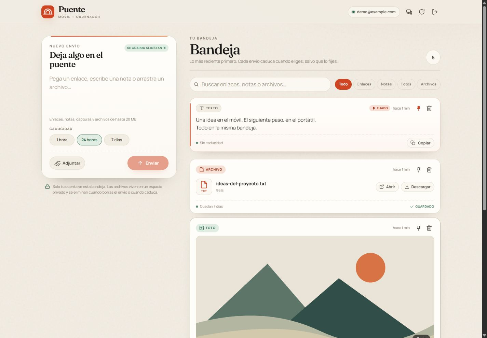
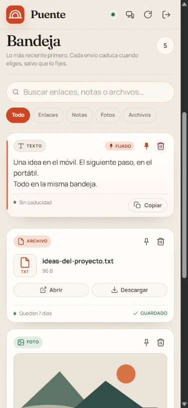
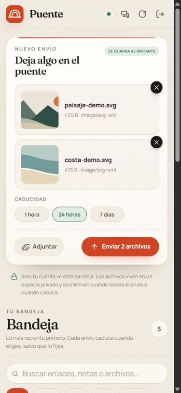
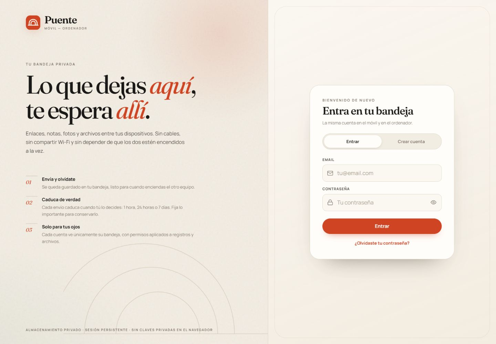

# Puente

Una bandeja privada para pasar enlaces, notas, fotos y archivos del móvil al portátil, y al revés.

[Abrir Puente](https://puente-api.qirris.workers.dev) · [Instalación](#instalar-puente-como-aplicación) · [Desarrollo local](#desarrollo-local)

Es un proyecto personal. El despliegue requiere una cuenta y el registro está protegido por un código de invitación; el enlace no da acceso a una demo pública.



*La bandeja en escritorio. Todas las capturas usan una cuenta y contenido de demostración en un entorno local.*

## ¿Por qué hice Puente?

Creé Puente porque cada vez que quería pasar algo del móvil al portátil, o al revés, acababa enviándomelo por WhatsApp o subiéndolo a Drive. Para algo tan sencillo perdía demasiado tiempo. Quería abrir una aplicación, dejar allí el archivo, la foto o el enlace y encontrarlo en el otro dispositivo.

De ahí salió la idea: una misma bandeja para mis dispositivos, sin tener que buscar después en un chat o en una carpeta dónde había dejado cada cosa. No hace falta que los dos estén encendidos a la vez ni conectados a la misma Wi-Fi.

**Lo desarrollé con ayuda de inteligencia artificial.** Partí de un problema que tenía en mi día a día y utilicé la IA como ayuda para construir la aplicación. Lo comparto aquí con su código y su documentación, incluyendo sus limitaciones.

## Qué puedes hacer

- **Dejar algo y recogerlo en otro dispositivo:** enlaces, notas, fotos y archivos de hasta 20 MB por archivo.
- **Enviar varios archivos de una vez:** seleccionarlos o arrastrarlos, revisar las vistas previas y quitar alguno antes de enviarlos. Se suben en orden, con progreso visible.
- **Encontrar lo que enviaste:** buscar por texto o nombre de archivo y filtrar entre enlaces, notas, fotos y archivos.
- **Elegir cuánto se conserva:** 1 hora, 24 horas o 7 días; fijar un envío para que no caduque.
- **Usarlo como aplicación:** instalar Puente en el móvil o el ordenador y aplicar nuevas versiones desde el aviso «Actualización pendiente».
- **Gestionar el acceso:** revisar las sesiones abiertas, cerrar las que no reconozcas y generar un código de recuperación.

## Un vistazo por dentro

<table>
  <tr>
    <th>Tu bandeja en vista móvil</th>
    <th>Varias imágenes en un envío</th>
  </tr>
  <tr>
    <td align="center"></td>
    <td align="center"></td>
  </tr>
  <tr>
    <td>Busca, filtra, copia o descarga lo que dejaste desde el otro dispositivo.</td>
    <td>Revisa las imágenes y elige la caducidad antes de enviarlas.</td>
  </tr>
</table>

*Vistas móviles capturadas en un navegador a 390 × 844 píxeles; no son fotografías de un teléfono.*



*La misma cuenta en el móvil y en el ordenador. [Cómo se prepararon las capturas](docs/capturas/README.md).*

## Cómo usarlo

1. Abre Puente e inicia sesión con la misma cuenta en tus dispositivos. Para crear una cuenta en este despliegue necesitas una invitación.
2. Pega un enlace, escribe una nota o adjunta uno o varios archivos. Elige la caducidad y pulsa **Enviar**.
3. Abre la bandeja en el otro dispositivo: puedes copiar el texto, abrir el enlace, previsualizar las imágenes o descargar los archivos.

La bandeja comprueba si hay cambios cada 10 segundos mientras está visible. Los envíos no fijados caducan según el plazo elegido; la limpieza de registros y archivos se ejecuta cada hora.

## Tecnologías

| Parte | Tecnología |
| --- | --- |
| Interfaz | React 19, TypeScript y Vite |
| API y recursos estáticos | Cloudflare Workers |
| Datos y sesiones | Cloudflare D1 (SQLite) |
| Archivos | Cloudflare Workers KV |
| Pruebas | Vitest, con SQLite en memoria y KV de prueba |
| Instalación | PWA con manifiesto y service worker |

La interfaz y la API se sirven desde el mismo Worker. Las fuentes se alojan en el proyecto. La arquitectura completa está en [Arquitectura](instrucciones/ARQUITECTURA.md).

## Desarrollo local

Necesitas **Node.js 24 o superior** y npm. Las pruebas del Worker utilizan `node:sqlite`.

```bash
git clone https://github.com/qirris/puente.git
cd puente
npm ci
npm run build
npx wrangler d1 migrations apply puente-datos --local
```

Arranca la API y la interfaz en dos terminales distintas:

```bash
# Terminal 1: API y almacenamiento locales
npm run dev:api -- --local
```

```bash
# Terminal 2: interfaz
npm run dev
```

Abre [localhost:5173](http://localhost:5173). Vite redirige las peticiones `/api` a Wrangler en el puerto 8787. La base de datos y los archivos locales se guardan en `.wrangler/state/`.

Si no configuras `PUENTE_CODIGO_INVITACION`, puedes crear una cuenta local sin código. Ese comportamiento es para desarrollo: configura el secreto para proteger el registro de un despliegue propio. No guardes su valor en el repositorio.

Para comprobar el proyecto:

```bash
npm test           # 60 pruebas automáticas
npm run build      # comprobación de tipos y compilación de producción
```

El procedimiento completo está en [Pruebas](instrucciones/PRUEBAS.md).

## Instalar Puente como aplicación

Abre [Puente](https://puente-api.qirris.workers.dev) con conexión:

- **Ordenador:** utiliza la opción de instalar la aplicación del navegador, cuando esté disponible.
- **Android:** en Chrome, utiliza la opción de instalar o añadir a la pantalla de inicio.
- **iPhone:** en Safari, abre el menú de compartir y elige **Añadir a la pantalla de inicio**.

La aplicación guarda la interfaz para facilitar la apertura. Enviar, sincronizar y descargar contenido requiere conexión.

Puente comprueba si hay una nueva versión al abrirse, al volver a ella y cada minuto mientras está visible y hay conexión. Cuando está lista, muestra **Actualización pendiente** con el botón **Actualizar ahora**. Termina tus envíos antes de pulsarlo: la app se recargará.

Si tienes una versión anterior a ese aviso, cierra y vuelve a abrir Puente con conexión. No hace falta desinstalarla.

## Despliegue propio

Para alojar tu propia instancia, necesitas una cuenta de Cloudflare y Wrangler autenticado. En `wrangler.toml`, configura tus propios recursos D1 y KV y los bindings `PUENTE_DB` y `PUENTE_ARCHIVOS`.

Aplica las migraciones a tu base de datos y configura el código de invitación como secreto antes de publicar:

```bash
npx wrangler login
npx wrangler d1 migrations apply puente-datos --remote
npx wrangler secret put PUENTE_CODIGO_INVITACION
npm test
npm run build
npm run deploy
```

El comando de migraciones supone que has llamado `puente-datos` a tu base; si usas otro nombre, sustitúyelo. El Worker sirve `dist/` y la API en `/api/*`. El despliegue es manual: la integración continua comprueba el código, pero no publica la app.

Consulta [Operaciones](docs/OPERACIONES.md) para los recursos, las copias de seguridad, la limpieza y la vuelta a una versión anterior.

## Ámbito, privacidad y limitaciones

Puente nació para uso personal. El despliegue actual no es un servicio abierto al público y depende de las cuotas de Cloudflare; compartir el código no garantiza disponibilidad ni capacidad para uso masivo.

- Cada cuenta accede únicamente a sus envíos mediante las comprobaciones del Worker. Las contraseñas se guardan como hash PBKDF2; el acceso usa sesiones propias y tiene un límite de intentos fallidos.
- Las vistas previas y las descargas llevan el token de sesión en la URL. Es una limitación conocida, mitigada con `Referrer-Policy: no-referrer` y `Cache-Control: no-store`; evita compartir esas URL.
- La recuperación de contraseña no utiliza correo. Guarda el código de recuperación: si lo pierdes y no tienes una sesión activa, no hay recuperación automática. El código caduca en una hora y admite cinco intentos.
- Workers KV tiene propagación eventual: un archivo recién subido puede tardar unos segundos en estar disponible desde otra ubicación.
- La sincronización se hace por sondeo, y los dos dispositivos necesitan conexión para intercambiar contenido.

Los detalles están en [Seguridad](instrucciones/SEGURIDAD.md) y en la [política para informar de vulnerabilidades](SECURITY.md).

## Más documentación

- [Cambios por versión](CHANGELOG.md).
- [Cómo colaborar](CONTRIBUTING.md).
- [Decisiones del proyecto](instrucciones/DECISIONES.md).
- [Código de la API](src/index.ts) y [migraciones](migrations/).

Proyecto en español, compartido bajo [licencia MIT](LICENSE).
